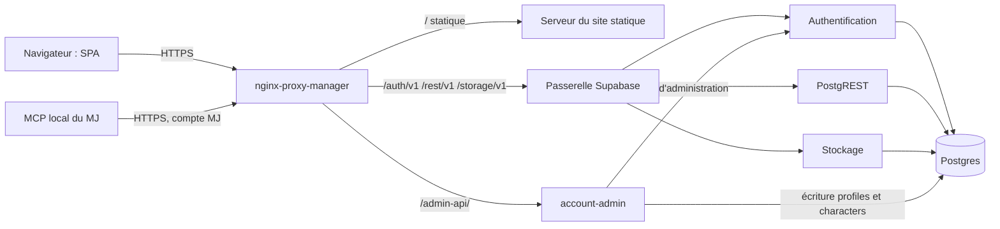
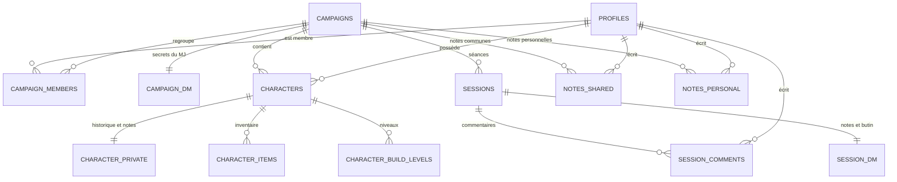
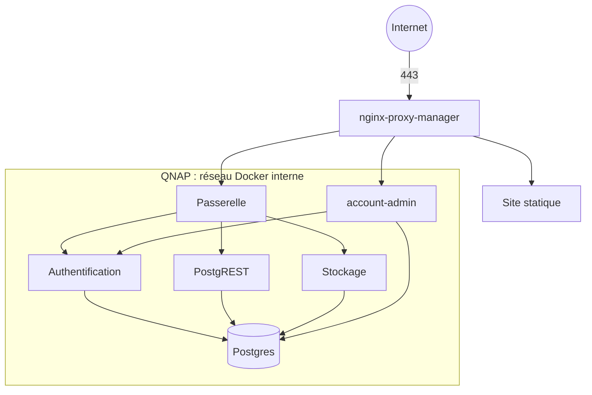

# Architecture Spine — dnd-maintainer-app : page joueur

## Design Paradigm

**La base fait autorité.** L'application est une SPA qui parle directement à PostgREST, à l'authentification et au
stockage. Toute règle d'accès est appliquée par la base (RLS et fonctions `SECURITY DEFINER`) ; l'interface masque ce
qu'on ne peut pas faire, par commodité. Un seul composant serveur personnalisé existe, pour la gestion des comptes.

| Couche                                               | Emplacement                                   |
| ---------------------------------------------------- | --------------------------------------------- |
| Pages et composants                                  | `src/pages/`, `src/components/`               |
| Hooks d'accès aux données (seuls à appeler Supabase) | `src/hooks/`                                  |
| Client Supabase, client du composant de comptes      | `src/lib/supabase.ts`, `src/lib/admin-api.ts` |
| Schéma, RLS, fonctions, tests SQL                    | `supabase/migrations/`, `supabase/tests/`     |
| Composant de gestion des comptes                     | `services/account-admin/`                     |

## Invariants & Rules



### AD-1 — La RLS est l'unique autorité d'accès

- **Binds:** FR-7, FR-8, FR-14, FR-15, FR-16 à FR-22, NFR-1
- **Prevents:** un droit appliqué seulement dans l'interface ; une table ou une fonction ouverte à `anon` par les droits
  par défaut de Supabase ; une vue qui contourne la RLS.
- **Rule:** chaque table de `public` a `ENABLE ROW LEVEL SECURITY` dans la migration qui la crée, avec ses policies.
  Aucune policy `USING (true)`. Les droits par défaut de `anon` sont révoqués (`ALTER DEFAULT PRIVILEGES ... REVOKE`) et
  chaque migration accorde explicitement à `authenticated` les seuls droits nécessaires. Toute vue est créée avec
  `security_invoker = true`. Chaque table dispose, dans `supabase/tests/`, de sa matrice opération × identité (AD-14).

### AD-2 — Un seul composant serveur personnalisé : `account-admin`

- **Binds:** FR-1, FR-4, FR-5, NFR-1, NFR-5b
- **Prevents:** deux endroits détenant la clé d'administration ; un jeton usurpé ou révoqué accepté ; un MJ enfermé dehors.
- **Rule:** `services/account-admin/` (service Node léger) est le **seul** détenteur de la clé d'administration de
  l'authentification (variable d'environnement du conteneur, jamais dans le dépôt) et le **seul propriétaire de la
  création des lignes `profiles`** (le script d'amorçage d'AD-15 appelle le même code). Actions : créer un compte,
  réinitialiser un mot de passe, archiver, réactiver, et rien d'autre. Chaque appel : (1) valide le jeton de l'appelant
  en appelant l'authentification (`GET /auth/v1/user`), ce qui rejette une session révoquée ; (2) refuse tout jeton dont
  le rôle n'est pas `authenticated` (en particulier `service_role`) ; (3) relit en base que `profiles.role = 'dm'` ;
  (4) refuse de cibler le compte MJ (archivage, réinitialisation) ; (5) valide le pseudo par `^[a-z0-9_-]{3,20}$`.
  Archiver : bannir le compte, supprimer ses sessions (`auth.sessions`, à vérifier sur la version installée), poser
  `archived_at` et désactiver ses personnages en les marquant `archived_with_owner = true`. Réactiver : lever le
  bannissement et ne réactiver **que** les personnages marqués. Réinitialiser : changer le mot de passe, **puis** poser
  `must_change_password = true` (voir AD-3). Joignable seulement par `/admin-api/`, avec limitation de débit. [PRÉCISE D-20 :
  ce n'est pas une edge function ; à confirmer par le propriétaire]

### AD-3 — Modèle d'identité : `profiles` + `campaign_members`

- **Binds:** FR-1 à FR-6, FR-26
- **Prevents:** un joueur qui s'auto-réactive ou change son rôle ; deux sources de vérité pour le rôle ; un marqueur de
  mot de passe jamais levé.
- **Rule:** `profiles(user_id, pseudo, role, must_change_password, archived_at)`, `user_id` référençant `auth.users`.
  `role` ∈ {`dm`, `player`} avec un **index unique partiel** : un seul `dm` (D-31). `pseudo` unique en minuscules ;
  l'adresse d'authentification est dérivée (`<pseudo>@<domaine>.invalid`), jamais affichée. **Aucun droit d'écriture sur
  `profiles` pour `authenticated`** (`REVOKE INSERT, UPDATE, DELETE`) : seules les écritures de `account-admin` (clé
  d'administration) et du trigger ci-dessous existent. Lecture : chacun lit **son propre profil sans passer par
  `is_active_user()`** (pour que le front sache qu'il doit changer son mot de passe) ; le MJ lit tous les profils.
  `must_change_password` est levé par un trigger `AFTER UPDATE OF encrypted_password ON auth.users` ; `account-admin` le
  repose à `true` après une réinitialisation. `campaign_members(campaign_id, user_id)` : **écriture réservée au MJ**. Le
  MJ est `dm` de toutes les campagnes sans y figurer. Aucun droit n'est lu dans `user_metadata` ni `app_metadata`.
  [ADOPTED : D-31]

### AD-4 — L'accès actif est une policy restrictive sur toute table

- **Binds:** FR-3, FR-5, FR-7, NFR-1
- **Prevents:** un joueur archivé ou au mot de passe temporaire qui garde accès (les policies permissives se combinent
  par OU : une règle « propriétaire » oubliée l'ouvrirait) ; la récursion de policies.
- **Rule:** `is_dm()`, `is_active_user()`, `is_member(campaign_id)`, `owns_character(character_id)` sont
  `SECURITY DEFINER STABLE`, `SET search_path = ''`, références qualifiées, `REVOKE EXECUTE ... FROM PUBLIC, anon`.
  `is_active_user()` lit `profiles` **en direct** (`archived_at IS NULL` et `must_change_password = false`). Chaque table
  de `public` **et** `storage.objects` porte une policy `AS RESTRICTIVE FOR ALL TO authenticated USING (is_dm() OR
is_active_user())`, vérifiée en CI (AD-14) : l'archivage prend effet immédiatement, sans attendre le jeton. Les
  policies propriétaire et auteur incluent aussi `is_member(campaign_id)`. Les colonnes de liaison (`campaign_id`,
  `session_id`, `character_id`, `author_id`, `owner_user_id`) sont **immuables** à la modification pour un non-MJ. Dans
  les policies : `(select auth.uid())`.

### AD-5 — Les données privées vivent dans des tables séparées

- **Binds:** FR-15, FR-17, FR-20
- **Prevents:** une colonne secrète lisible parce que la RLS filtre les lignes, pas les colonnes ; une saisie perdue sur
  une ligne privée absente.
- **Rule:** aucune colonne privée dans une table lisible par les joueurs. Tables `character_private(character_id,
backstory, notes)`, `session_dm(session_id, notes, loot, experience_awarded)`, `campaign_dm(campaign_id, dm_notes)` ;
  ces colonnes disparaissent des tables d'origine. `character_private` : propriétaire et MJ. `session_dm`,
  `campaign_dm`, `encounters` et la table `notes` actuelle : MJ seul. Un trigger `AFTER INSERT` sur `characters`,
  `sessions` et `campaigns` crée la ligne privée vide. Toute mutation du front et du MCP vérifie le **nombre de lignes
  affectées** (une écriture bloquée par la RLS touche 0 ligne sans erreur).

### AD-6 — Visibilité et garde des personnages

- **Binds:** FR-8, FR-9, FR-12, FR-14, FR-15, FR-5
- **Prevents:** un joueur qui se déclare PNJ pour se cacher, change de propriétaire, déplace un personnage ou choisit un
  slug ; une garde qui bloque l'archivage ou le renommage.
- **Rule:** `characters.owner_user_id` (nullable, `ON DELETE SET NULL`) et `characters.archived_with_owner`. Lecture : le
  MJ tout ; le propriétaire ses personnages ; un autre membre seulement `character_type = 'pc'` de sa campagne.
  Écriture : propriétaire ou MJ. `INSERT` joueur : `owner_user_id = auth.uid()`, type `pc`, campagne dont il est membre,
  slug **toujours généré par le serveur**. `DELETE` : MJ seul. Un trigger `BEFORE UPDATE`, nommé pour s'exécuter
  **avant** le trigger de slug (ordre alphabétique), refuse à un utilisateur `authenticated` non MJ toute modification
  de `owner_user_id`, `campaign_id`, `character_type`, `is_active`, `archived_with_owner`, `slug`, `previous_slugs`.
  Il ne s'applique **qu'à** ce rôle : la clé d'administration, les migrations et le MJ le contournent. `character_items`
  et `character_build_levels` suivent `owns_character()` en écriture et la lecture d'un PJ de la campagne en consultation.

### AD-7 — Tables de contenu des joueurs

- **Binds:** FR-16 à FR-22, NFR-10
- **Prevents:** un auteur falsifié, une écriture hors de sa campagne, un MJ empêché de modérer, un texte démesuré.
- **Rule:** `notes_personal`, `notes_shared`, `session_comments` portent `campaign_id` et `author_id` (défaut
  `auth.uid()`). Policies **joueur** : insertion si `is_member(campaign_id)` et `author_id = auth.uid()` ; modification
  et suppression si auteur **et** membre ; colonnes de liaison immuables (AD-4). Policy **MJ distincte** : modifier et
  supprimer `notes_shared` et `session_comments`, **lecture seule** de `notes_personal` (FR-17). `notes_personal` :
  lecture auteur et MJ. Texte brut, longueur bornée par `CHECK` (10 000 caractères) ; toute colonne `jsonb` écrivable par
  un joueur porte une borne d'`octet_length`. `sessions.summary_published` (MJ seul en écriture) ouvre la lecture de
  `sessions` aux membres ; `session_comments` n'accepte l'insertion que si la séance est publiée **et** de la même
  campagne.

### AD-8 — Portraits : bucket privé et URL signées

- **Binds:** FR-13, FR-14, FR-15
- **Prevents:** la lecture ou l'énumération des portraits par un visiteur ou des PNJ par un joueur ; l'écrasement du
  portrait d'autrui ; une adresse externe dans la fiche.
- **Rule:** bucket `character-portraits` **privé**. Les quatre policies ouvertes de `storage.objects` existantes sont
  **supprimées** dans la migration. Objets nommés `<id-personnage>/<id-aléatoire>.<ext>`. Lecture : MJ, propriétaire, et membres
  de la campagne pour un PJ (`owns_character()` / appartenance sur le premier segment, avec garde contre un segment non
  UUID). Écriture, mise à jour, suppression : propriétaire ou MJ. Le front obtient des **URL signées** de courte durée
  (`createSignedUrl`), mises en cache par TanStack Query. La fiche stocke le **chemin** de l'objet, pas une URL, avec un
  `CHECK` sur le format ; limites existantes conservées (1 Mo, images).

### AD-9 — Exposition : seule la passerelle HTTP sort, avec l'IP réelle

- **Binds:** NFR-5, NFR-5b, FR-2
- **Prevents:** la base, Studio ou les services internes joignables depuis Internet ; une limitation de débit qui bloque
  tous les joueurs (IP du proxy) ou qu'un client contourne (en-tête ajouté plutôt qu'écrasé).
- **Rule:** nginx-proxy-manager est le seul point d'entrée (80 et 443). Il publie le site statique, `/auth/v1`,
  `/rest/v1`, `/storage/v1` et `/admin-api/`. La base, Studio et le service de métadonnées ne sont ni publiés ni
  démarrés. Le proxy **écrase** l'en-tête de l'IP du client (jamais de concaténation) ; Kong et l'authentification sont
  configurés pour lui faire confiance (IP de confiance, en-tête réel, `GOTRUE_RATE_LIMIT_HEADER`) ; une vérification à
  l'installation prouve que deux clients distincts ont des compteurs distincts. En-têtes : HSTS, CSP, `nosniff`,
  `frame-ancestors 'none'`.

### AD-10 — Pile Supabase allégée, soumise à l'essai de charge

- **Binds:** NFR-4, SM-4
- **Prevents:** une installation qui sature le QNAP (environ 2 Go de RAM disponibles) ; des clés de démonstration en
  production.
- **Rule:** services démarrés : base (Postgres 17), authentification, PostgREST, stockage, passerelle (Kong). Exclus :
  Studio, temps réel, métadonnées, analytics, vector, fonctions edge. L'essai de charge (5 joueurs) valide au moins
  500 Mo de mémoire disponible ; sinon repli sur Supabase cloud (D-20). Tous les secrets sont régénérés avant la mise en
  ligne : secret de signature des jetons, clés publique et d'administration, mot de passe de la base, clés du composant
  de comptes. [ADOPTED : D-20]

### AD-11 — Configuration de l'authentification

- **Binds:** FR-2, FR-3, FR-4, FR-5, NFR-1
- **Prevents:** une inscription ouverte avec la clé publique ; une session qui survit à un changement de statut ; un
  joueur qui change son adresse d'authentification.
- **Rule:** inscription désactivée (`GOTRUE_DISABLE_SIGNUP=true`) ; comptes créés confirmés (aucun envoi d'e-mails) ;
  mot de passe minimal de 10 caractères ; jeton valable 3600 s avec rotation du jeton de rafraîchissement ; le
  changement d'adresse par un utilisateur est désactivé (à vérifier sur la version installée). Aucune autorisation ne
  repose sur le contenu du jeton : la base relit `profiles` (AD-4). **Verrouillage par pseudo** : il n'est pas natif ;
  il s'implémente par le hook de vérification de mot de passe de l'authentification **si** la version installée le
  permet, sinon seule la limitation par IP s'applique et le PRD (FR-2) est amendé. [À VÉRIFIER]

### AD-12 — Front : l'interface suit la base

- **Binds:** FR-2, FR-3, FR-23 à FR-25
- **Prevents:** une logique d'autorisation dupliquée dans l'interface qui diverge de la RLS.
- **Rule:** un `AuthProvider` et une garde de routes ; le rôle et l'état viennent de `profiles` via un hook. Seuls les
  hooks de `src/hooks/` appellent Supabase ; le composant de comptes n'est appelé que par `src/lib/admin-api.ts`. Aucune
  clé d'administration dans le bundle. Tout texte passe par `react-i18next` (français par défaut, anglais). Interface
  adaptative, conçue d'abord pour le petit écran.

### AD-13 — Migration unique et transactionnelle, MCP suivi

- **Binds:** FR-27, NFR-7
- **Prevents:** des données perdues entre une copie et une suppression de colonnes ; une base ouverte sur Internet
  pendant la transition ; un MCP cassé ou déconnecté au bout d'une heure.
- **Rule:** la bascule est **une seule migration transactionnelle** : créer identité, tables privées et de contenu,
  copier les champs privés, supprimer les anciennes colonnes, remplacer les policies, révoquer `anon`. Elle est déployée
  **en même temps** que le front et le MCP. La pile n'est **pas publiée** sur Internet avant son application. Le MCP se
  connecte avec le compte MJ (`signInWithPassword`, identifiants en variables d'environnement) avec
  `autoRefreshToken: true`, utilise les nouvelles tables, et vérifie le nombre de lignes affectées (voir AD-5).

### AD-14 — Les règles d'accès sont testées en SQL

- **Binds:** NFR-7, SM-2, FR-7
- **Prevents:** une policy correcte sur le papier mais fausse en pratique ; une régression silencieuse ; des écritures
  bloquées sans erreur.
- **Rule:** tests pgTAP dans `supabase/tests/`, lancés par `supabase test db` en CI. Pour **chaque** table, chaque
  opération et chaque identité (anonyme, joueur propriétaire, autre joueur, joueur archivé, joueur au mot de passe
  temporaire, non-membre, MJ). Un `UPDATE` ou `DELETE` bloqué par la RLS touche **0 ligne sans erreur** : le test vérifie
  le nombre de lignes ; un `INSERT` ou un `WITH CHECK` refusé lève l'erreur `42501`. Contrôles de structure : aucune
  policy `true`, la policy restrictive d'AD-4 sur chaque table et sur `storage.objects`, aucun droit de `anon`.

### AD-15 — Le premier compte MJ est créé hors de l'application

- **Binds:** FR-1, FR-27
- **Prevents:** une route d'amorçage exploitable ; deux créateurs concurrents de profils.
- **Rule:** le compte MJ est créé une fois, depuis le QNAP, par le propriétaire, avec un script documenté qui appelle le
  **même code** que `account-admin` (AD-2). Aucune route de l'application ne crée un MJ ; l'index unique d'AD-3 empêche
  un second `dm`.

## Consistency Conventions

| Concern                 | Convention                                                                                                                |
| ----------------------- | ------------------------------------------------------------------------------------------------------------------------- |
| Naming                  | tables et colonnes en `snake_case` ; hooks `useXxx` ; migrations `AAAAMMJJHHMMSS_description.sql` ; services `kebab-case` |
| Data & formats          | clés `uuid` ; dates `timestamptz` ; texte brut ; erreurs PostgREST non affichées telles quelles à l'utilisateur           |
| State & cross-cutting   | état serveur par TanStack Query ; journaux via `getLogger` ; aucun secret dans le dépôt ni le bundle                      |
| Sécurité d'une fonction | `SECURITY DEFINER` seulement avec `SET search_path = ''` et `REVOKE` explicite                                            |

## Stack

| Name                         | Version                                                                                            |
| ---------------------------- | -------------------------------------------------------------------------------------------------- |
| React / react-dom            | 19.2                                                                                               |
| Vite                         | 8                                                                                                  |
| TypeScript                   | 6                                                                                                  |
| react-router-dom             | 7.17                                                                                               |
| @supabase/supabase-js        | 2.107                                                                                              |
| @tanstack/react-query        | 5.101                                                                                              |
| Zod                          | 4.4                                                                                                |
| Tailwind CSS                 | 4.3                                                                                                |
| i18next / react-i18next      | 26.3 / 17.0                                                                                        |
| Vitest / Cucumber            | 4.1 / 13                                                                                           |
| Postgres                     | 17                                                                                                 |
| Node (composant de comptes)  | 24 (selon `.nvmrc`)                                                                                |
| Supabase auto-hébergé        | images à épingler à l'installation, d'après le `docker-compose.yml` officiel de la version retenue |
| Supabase CLI (tests SQL, CI) | 2.x (la configuration actuelle n'est pas valide en 3.x)                                            |

## Structural Seed





```text
dnd-maintainer-app/
  services/account-admin/   # composant de gestion des comptes (AD-2)
  supabase/migrations/      # schéma, RLS, fonctions (AD-1, AD-3 à AD-8)
  supabase/tests/           # tests pgTAP (AD-14)
  src/lib/admin-api.ts      # client du composant de comptes
  src/hooks/                # seuls à appeler Supabase (AD-12)
```

## Capability → Architecture Map

| Capability / Area                             | Lives in                                                | Governed by             |
| --------------------------------------------- | ------------------------------------------------------- | ----------------------- |
| Comptes, connexion, archivage (FR-1 à FR-5)   | `services/account-admin/`, `profiles`, authentification | AD-2, AD-3, AD-4, AD-11 |
| Appartenance, campagnes (FR-6, FR-26)         | `campaign_members`, `campaigns`                         | AD-3, AD-4              |
| Contrôle d'accès base (FR-7)                  | policies et fonctions SQL                               | AD-1, AD-4, AD-14       |
| Fiche joueur et autres fiches (FR-8 à FR-15)  | `characters`, `character_private`, stockage             | AD-5, AD-6, AD-8        |
| Notes et commentaires (FR-16 à FR-19, FR-22)  | `notes_personal`, `notes_shared`, `session_comments`    | AD-7                    |
| Récapitulatifs (FR-20, FR-21)                 | `sessions`, `session_dm`                                | AD-5, AD-7              |
| Interface (FR-23 à FR-25)                     | `src/`                                                  | AD-12                   |
| Migration et MCP (FR-27)                      | migrations, `dnd-maintainer-mcp`                        | AD-13, AD-15            |
| Exposition, ressources (NFR-4, NFR-5, NFR-5b) | proxy, Docker                                           | AD-9, AD-10             |

## Deferred

- **Kong ou routage direct par le proxy** : Kong est conservé ; on ne bascule que si l'essai de charge manque de mémoire.
- **Transformation d'images (imgproxy)** : non démarrée ; les portraits ne sont pas redimensionnés côté serveur.
- **Sauvegardes** : écartées (D-23) ; à réexaminer avant d'accueillir des données irremplaçables.
- **Observabilité** : journaux des conteneurs seulement ; pas de métriques en v1.
- **Validation serveur du moteur de règles** : hors périmètre (D-03).
- **Traduction des données de règles** : lots ultérieurs (D-28).
